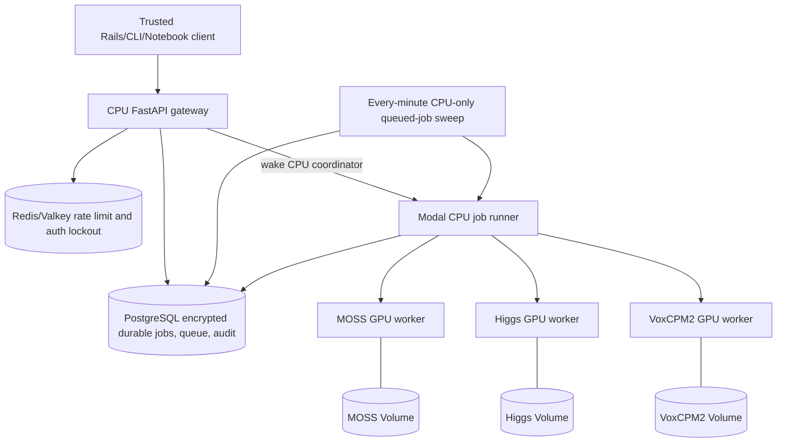
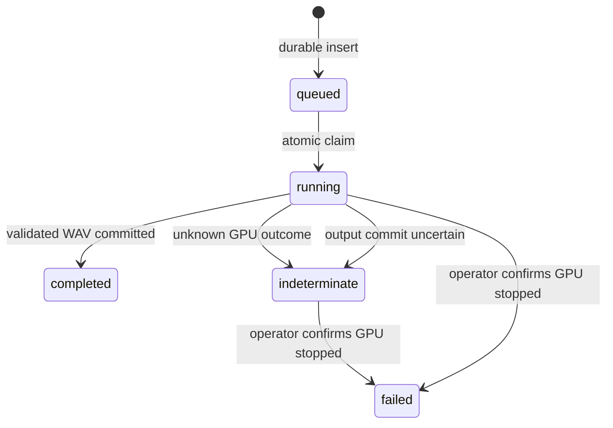

# Durable TTS architecture

> 🌐 Language / Ngôn ngữ: **English** | [Tiếng Việt](ARCHITECTURE.vi.md)

🌐 [English](ARCHITECTURE.md) | [Tiếng Việt](ARCHITECTURE.vi.md)

**PostgreSQL is the system of record**, not Modal Dict. The gateway authenticates and validates before persisting an encrypted job. It checks an atomic Redis rate limit and PostgreSQL outstanding limits. A CPU runner claims queued work using a database-wide admission lock, then calls exactly one GPU worker. Each model has its own Modal GPU class and Volume, with GPU `min_containers=0`. A CPU-only scheduled sweep recovers work still in `queued` state after a lost wake-up acknowledgment.

## State transitions

A status GET also **reports** an overdue `running` job as `indeterminate` after 180 seconds without heartbeat, without writing a new database state. A late successful result can still commit in that case. By contrast, when the CPU coordinator observes a remote-call exception or loses the result, it persists an `indeterminate` state. Both `running` and persisted `indeterminate` reserve that model's single dispatch slot; only confirmed manual termination or terminal success frees it. **No automatic GPU retry** is ever attempted. The application cannot guarantee exactly-once execution across ambiguous remote failures.

The gateway does **not** block on GPU inference. Its POST response is HTTP 202 with an opaque job ID. If the immediate CPU wake fails, it still returns an accepted, durable `queued` job; the once-per-minute CPU sweep re-signals it. Duplicate wake-ups are harmless because only one runner can claim the row at a time under PostgreSQL locking.

## Storage and privacy

Idempotency fingerprint: owner-scoped HMAC-SHA-256 of the canonical request hash, keyed using domain-separated material derived from the persistent Fernet key. Alembic revision 0002 adds fingerprint versioning. Startup converts legacy SHA-256 metadata in small, restartable, admission-locked batches without selecting encrypted WAV or input columns. An expand-only schema keeps older in-flight runners compatible, while the next migration restores compatibility for databases that already used a rename-based schema. Old backups still expose legacy digests and need appropriate protection. Key rotation requires a planned migration.

- Requests: text, selected model config and optionally authorized reference WAV, serialized and encrypted with Fernet before storing in PostgreSQL. An `encrypted_input` column is deleted on successful completion or terminal/uncertain handling.
- Results: validated WAV bytes are encrypted with Fernet and stored in PostgreSQL (max 32 MB) in this version; audio is **not** retained indefinitely in Modal Dict. This is durable across gateway/process restarts, but large BYTEA objects can become costly and backups large. Object storage such as S3/R2 is a sensible next step; it is **not implemented** here.
- Metadata: owner ID, keyed digest, timestamps, aggregate audio metadata and minimal audit events; no raw prompts, WAVs, tokens or client IPs in the application audit table.
- Deletion: completed/confirmed-failed job metadata, encrypted WAV and associated audit events are purged transactionally after `TEXT_TO_SPEECH_COMPLETED_JOB_RETENTION_DAYS` (default seven days). Queued, running and indeterminate jobs and their audit events are preserved for manual reconciliation. Database backups and Modal transport have independent retention.
- Keys: keep the stable Fernet encryption key and migration/backup procedures in an approved secret manager. Losing the key makes queued inputs and completed audio irrecoverable; rotating it requires a planned re-encryption migration.

## Scaling and cost boundaries

- `admission_lock` is one PostgreSQL row locked with `SELECT ... FOR UPDATE`. This serializes claims/admissions across replicas, including per-client and per-model limits. It prioritizes correctness over very high throughput; SQLite tests cannot prove PostgreSQL isolation in deployment.
- Redis/Valkey Lua checks apply fixed-window pre-auth and shared job/poll quotas; any Redis outage causes the protected API to reject traffic (fail closed). Redis stores only hashed identities, not raw tokens or IP strings.
- A single running or uncertain job per model preserves the worker's one-GPU capacity. Model workers are independent; Higgs usage additionally requires explicit license authorization.
- Redis limits count requests; optional PostgreSQL admission budget reserves a **fixed estimated USD amount per newly accepted GPU job** across all clients for each UTC day (migration `0006`). Idempotent replays do not reserve twice. This is not actual usage metering or a hard billing limit: configure a real spending cap in Modal. Cold starts, CPU, database, storage and provider adjustments remain outside this estimate.

See [Security](SECURITY.md), [Deployment](DEPLOYMENT.md) and [API](API.md).

Owner-scoped client diagnostics expose allowlisted audit lifecycle events, bounded timing fields and redacted error codes. They never expose raw GPU logs, input, voice references or credentials. Revision `0004` adds nullable job claim timestamps, text-character counts, GPU RPC wall time and PCM validation time. Token counts/model-load timing remain `null` until a real backend provides them.
