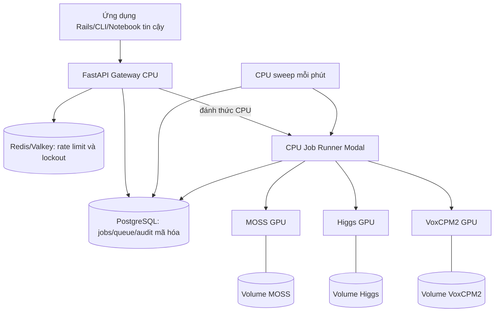

# Kiến trúc hàng đợi TTS bền vững

> 🌐 Language / Ngôn ngữ: [English](ARCHITECTURE.md) | **Tiếng Việt**

🌐 [English](ARCHITECTURE.md) | [Tiếng Việt](ARCHITECTURE.vi.md)

**PostgreSQL là nguồn dữ liệu chính thức.** API xác thực, kiểm tra input, áp rate-limit nguyên tử trên Redis và giới hạn số job chưa hoàn tất trong PostgreSQL trước khi ghi job được mã hóa. CPU runner claim job bằng một hàng khóa `SELECT ... FOR UPDATE`, sau đó gọi đúng worker GPU tương ứng. Ba GPU class và ba Volume độc lập, `min_containers=0`; gateway không mount trọng số model.

## Trạng thái và an toàn GPU

- `queued` → `running` khi CPU runner claim thành công.
- `running` → `completed` khi WAV hợp lệ đã ghi vào PostgreSQL.
- `running` → `indeterminate` khi không thể xác nhận kết quả GPU hoặc việc ghi output; **không tự retry**.
- `running`/`indeterminate` → `failed` chỉ qua thao tác của người vận hành **sau khi xác nhận GPU đã dừng**.

GET có thể hiển thị trạng thái `indeterminate` khi heartbeat `running` quá 180 giây dù chưa sửa hàng database; kết quả đến muộn vẫn có thể lưu thành công. Job `indeterminate` lưu trong DB vẫn giữ slot GPU của model để không chạy nhầm tác vụ mới chồng lên GPU chưa chắc đã dừng. Không thể cam kết exactly-once khi mất xác nhận từ dịch vụ GPU.

Sau khi PostgreSQL nhận job, gateway trả HTTP 202. Nếu đánh thức runner thất bại, job vẫn ở `queued`; CPU sweep mỗi phút sẽ phát tín hiệu lại cho các job **queued**, không tự retry job đang `running` hay `indeterminate`. Các lần đánh thức lặp không tạo GPU request trùng vì chỉ một runner được claim.

## Lưu trữ và dữ liệu nhạy cảm

Fingerprint idempotency sử dụng HMAC-SHA-256 theo owner, với khóa dẫn xuất tách biệt từ Fernet key ổn định. Alembic revision 0002 bổ sung version; lúc khởi động, digest SHA-256 cũ được chuyển đổi theo batch ngắn, có thể chạy lại, dưới admission lock và không đọc các cột WAV/input mã hóa. Schema mới giữ cột cho runner cũ, đồng thời có migration tương thích với database đã đổi tên cột. Backup cũ vẫn cần bảo vệ; không tự ý xoay Fernet key nếu chưa có kế hoạch migration.

- Văn bản, tùy chọn model và WAV tham chiếu được mã hóa bằng Fernet trước khi lưu trong PostgreSQL. Xóa nội dung đầu vào sau khi xử lý xong hoặc chuyển sang trạng thái kết thúc/không chắc chắn.
- WAV đầu ra (tối đa 32 MB) được mã hóa và lưu trong PostgreSQL, phục hồi được sau restart gateway. **Cloudflare R2/S3 chưa được tích hợp**, vì vậy cần cân nhắc dung lượng BYTEA, backup và chi phí PostgreSQL.
- Chỉ lưu audit metadata giới hạn; không lưu token, prompt, audio hay IP trong audit ứng dụng. Log bên ngoài Modal/provider có chính sách lưu riêng.
- CPU sweep xóa job `completed`/`failed` được xác nhận cùng audit event tương ứng trong một transaction sau `TEXT_TO_SPEECH_COMPLETED_JOB_RETENTION_DAYS` (mặc định 7 ngày); giữ nguyên `queued`/`running`/`indeterminate` và audit của chúng. Backup có thời gian giữ riêng.
- Giữ khóa Fernet ổn định và sao lưu an toàn. Mất khóa sẽ không giải mã được dữ liệu; muốn xoay khóa cần quy trình mã hóa lại.

## Giới hạn vận hành

PostgreSQL khóa một hàng chung `admission_lock` để thực hiện kiểm tra quota/claim giữa các replica; ưu tiên tính đúng thay vì throughput cực cao. Redis/Valkey dùng Lua để áp quota phân tán và trả 503 (fail closed) khi Redis lỗi. Rate-limit không phải giới hạn chi phí tiền thật: cần thiết lập budget trên Modal. CPU tests với SQLite không thay thế kiểm thử PostgreSQL/Redis thật và GPU.

Xem [Bảo mật](SECURITY.vi.md), [Triển khai](DEPLOYMENT.vi.md) và [API](API.vi.md).

Diagnostics cho client chỉ trả timeline audit có giới hạn theo owner, các mốc timing và mã lỗi đã lọc; không công khai log GPU, input, giọng tham chiếu hoặc secrets. Revision `0004` thêm các cột nullable cho thời điểm claim, số ký tự, GPU RPC và kiểm tra PCM. Token counts và thời gian load model sẽ là `null` khi backend chưa đo được.
